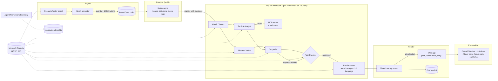

# Architecture

## Design decisions

**Numbers come from code, words come from agents.** The stats engine is deterministic and tested against
planted ground truth. Agents read the match only through MCP tools and a per-moment fact sheet, and the
Fact-Checker rejects any number, name or direction that is not in the evidence.

**AI calls are event-driven, not per event.** About 2,000 events per match produce roughly 15 to 20
narrative moments. Quick data tags (top speed, shot speed, pass difficulty) need no words, so they never
reach a model. That keeps a full match to about 100 model calls on a small, fast model.

**The broadcast never goes blank.** Every agent call has a timeout. If the Analyst or Judge fails, the
Storyteller still writes from the fact sheet; if the Storyteller fails twice, a deterministic template airs
and is labelled as unverified; if the Fan Producer fails, every language falls back to the verified English
line. The tests simulate each outage.

**Overlays are machine-readable.** Each overlay has a show time, duration, priority, side, player, evidence,
glossary terms, per-language and per-audience variants, and the full agent trace, so a graphics partner can
render it without calling back.

## Agent roles

| Agent | Input | Output | Tools |
|---|---|---|---|
| Scenario Writer | One-line storyline | Tactical timeline for both clubs | none |
| Match Director | Competing candidate moments | Which air, in order | none |
| Tactical Analyst | Signal | Observation, mechanism, key numbers, jargon | MCP match tools |
| Moment Judge | Signal, score, minute | Importance 0-100, stakes | win probability |
| Storyteller | Fact sheet, analyst note, verdict, feedback | Headline and two-sentence body | none |
| Fact-Checker | Story, evidence | Approve or list problems | deterministic checker |
| Fan Producer | Verified story, language | Casual, analyst, home-fan, away-fan versions | none |
| Recap writer | Match facts, aired moments | Full-time recap | none |
